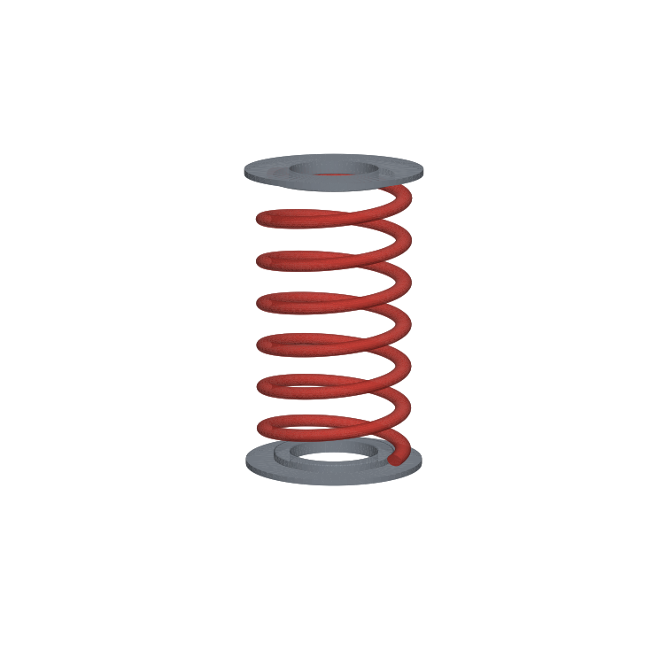

# coil-spring-cad

Parametric 3D CAD of a front suspension coil spring and its seats, built in Python with **CadQuery** (OpenCASCADE kernel). The script exports STEP files you can open in SolidWorks, Fusion 360, FreeCAD or Onshape, along with an STL, a front view SVG, a shaded render and a JSON report of spring data.

This is the CAD companion to [suspension-spring-calculator](https://github.com/gomdan133-ux/suspension-spring-calculator). The spring geometry here is the same example spring, and the tests check that the CAD model and the calculator agree.



## What it models

| Part | Feature |
|---|---|
| Coil spring | Round wire swept along a true helix (`Wire.makeHelix` + Frenet sweep), parametric wire diameter, mean coil diameter, active coils and pitch |
| Spring seats | Upper and lower seats with a centering lip that sits inside the coil ID |
| Assembly | Spring plus both seats, exported as one multi body STEP |

Default spec: 12.5 mm wire, 110 mm mean coil diameter, 6.5 active coils, 45 mm pitch, 305 mm free length.

## Engineering math

| Quantity | Formula |
|---|---|
| Spring rate | k = G·d⁴ / (8·D³·Na), with G = 79.3 GPa |
| Spring index | C = D / d |
| Wahl factor | Kw = (4C − 1)/(4C − 4) + 0.615/C |
| Shear stress | τ = Kw · 8FD / (πd³) |
| Wire length | L = Na · √((πD)² + p²) |
| Free length | Lf = Na·p + d |
| Solid height | Ls = (Na + 1)·d |

Design checks done before the CAD is built (a bad spec raises `ValueError`):
- index between 4 and 16 (a value outside this range is hard to coil, or the spring is too soft and unstable)
- pitch greater than wire diameter (otherwise the coils touch at rest)
- slenderness Lf/D at most 5.2 (buckling limit for squared ends on parallel seats)
- seat lip fits inside the coil inner diameter

## Results (default spec)

| Output | Value |
|---|---|
| Spring rate | 27.97 N/mm |
| Spring index / Wahl factor | 8.8 / 1.166 |
| Wire length | 2265 mm |
| Mass (steel) | 2.18 kg |
| Ride height load 4336 N | 155 mm deflection, 150 mm length, 725 MPa shear |
| Load at solid | 5909 N, 988 MPa shear |

988 MPa at solid is inside the normal range for chrome silicon suspension wire, so the spring can go solid without taking a set.

### CAD vs hand calculation

| Check | CAD | Hand calc | Error |
|---|---|---|---|
| Wire volume | 277,982.2 mm³ | 277,982.2 mm³ | < 0.0001% |
| Free length | 304.9 mm | 305.0 mm | 0.03% |
| Outside diameter | 122.5 mm | D + d = 122.5 mm | 0% |
| Spring rate | 27.97 N/mm | 28.0 N/mm (suspension-spring-calculator) | 0.1% |

## Output files

| File | Use |
|---|---|
| `coil_spring.step` | Spring solid for any CAD program |
| `spring_seat.step` | Lower seat |
| `spring_assembly.step` | Spring + both seats |
| `coil_spring.stl` | 3D print or mesh viewer |
| `spring_assembly_front.svg` | Front view line drawing |
| `spring_assembly.png` | Shaded render |
| `spring_report.json` | All numbers above |

## Run it

```bash
pip install cadquery matplotlib numpy pytest
python scripts/build_all.py
python -m pytest -q        # 10 tests
```

Change the spring by editing `SpringSpec` in `springcad/spring.py`, or in code:

```python
from springcad import SpringSpec, build_spring, rate_n_per_mm
s = SpringSpec(wire_d=13, active_coils=6)
print(rate_n_per_mm(s))
build_spring(s)
```

## Limits

- The ends are plain (open). Real suspension springs have closed and ground or pigtail ends. That changes solid height and the active coil count a little.
- The rate is linear. Progressive springs with variable pitch are not modeled.
- Stress is static shear only. No fatigue (Goodman) check.

## Tests

10 pytest tests: the solid is valid, free length and OD match the spec, CAD volume matches the hand calculation, the rate matches the suspension calculator, the Wahl factor is correct, stress is linear with load, the seats do not intersect the spring, and three bad specs are rejected.

## How this was built

1. Wrote `SpringSpec` with the derived values (free length, solid height, index) and design checks so impossible springs are rejected before any geometry is made.
2. Built the coil by sweeping a circle along a helix. The profile circle is tilted to the helix lead angle so it is normal to the path, and the sweep uses a Frenet frame so the wire does not twist along the coil.
3. Checked the solid against the hand calculation for wire volume (cross section × helix length). It matched to under 0.0001%, which shows the sweep is the right shape.
4. Modeled the seats with a centering lip, then tested that seat and spring do not intersect.
5. Ran the rate and stress math and compared the rate to suspension-spring-calculator (28.0 N/mm) to keep the two repos consistent.
6. Exported STEP, STL, SVG and a matplotlib shaded render, and wrote 10 tests.

Built with Claude (Anthropic) as a coding assistant; the engineering checks and results were reviewed by me.

## License

MIT
